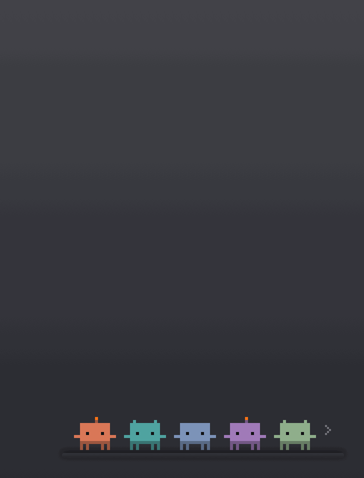
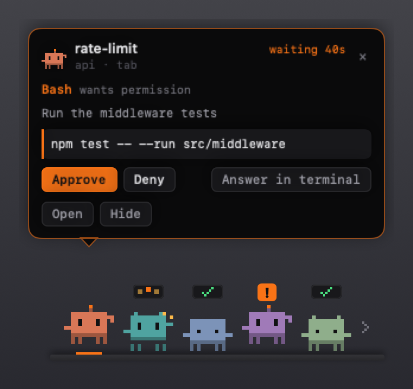
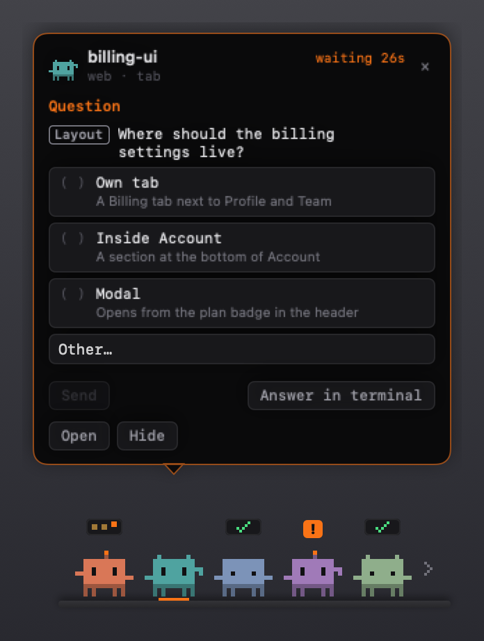
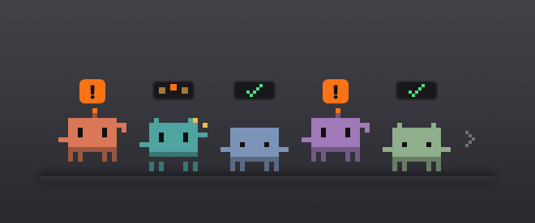
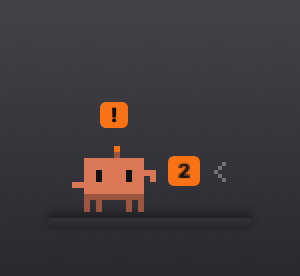

# Crewshelf

A shelf of pixel characters in a corner of your Mac's screen, one for every running Claude Code session. When an agent
needs a permission or asks a question, a speech bubble pops up and **you answer it right there**: Approve, Deny, or
pick an answer, even for background agents that have no terminal at all.



| A permission request | A question | The shelf | Collapsed |
| --- | --- | --- | --- |
|  |  |  |  |

All images come from `Crewshelf --demo` (made-up agents and paths).

A native Swift (AppKit + SwiftUI) app for macOS 13 or later, plus a small Claude Code plugin whose hooks talk to the
app over a local socket. Free and open source (MIT).

> **Unofficial.** Crewshelf is an independent project, not affiliated with, endorsed by or sponsored by Anthropic.
> "Claude" and "Claude Code" are trademarks of Anthropic, PBC, used here only to say what this works with.
> The characters are fan-made pixel art inspired by Claude Code's mascot, not Anthropic artwork, and Anthropic has not
> reviewed or approved them.

## Install

You need both halves: the **app** (the shelf) and the **plugin** (the hooks that send it requests).

### 1. The app

**A. Build from source (recommended).** Needs the Xcode Command Line Tools (`xcode-select --install`); nothing is
downloaded.

```sh
git clone https://github.com/aaliismail/crewshelf.git
cd crewshelf
./install.sh                         # compiles, runs the whole test suite, installs ~/Applications/Crewshelf.app
open ~/Applications/Crewshelf.app
```

`install.sh` compiles everything and runs the full test suite before it installs, printing each step as it goes;
`./install.sh --no-tests` skips the tests. `--dir /Applications` installs there instead. Run it again to update: it
quits the installed copy if it is running and replaces it; any other Crewshelf (a `--demo`, a copy somewhere else)
is left alone, and it says so. It never touches your Claude Code settings. An app you built yourself opens without
any Gatekeeper prompt.

**B. The release zip.** Download `Crewshelf-<version>.zip` from
[Releases](https://github.com/aaliismail/crewshelf/releases), unzip it and move `Crewshelf.app` to
`~/Applications` or `/Applications`. The app is ad-hoc signed, **not notarized** (there is no paid Apple Developer
ID behind it), so the first open is blocked:

1. Double-click `Crewshelf.app`. macOS says it "cannot be opened" or "could not verify" it. Click **Done** (not
   Move to Trash).
2. Open **System Settings > Privacy & Security**, scroll to **Security**, and click **Open Anyway** next to
   "Crewshelf was blocked". Confirm with your password or Touch ID, then **Open Anyway** once more.

   On macOS 15 and later, right-click > Open no longer skips this; the Settings button is the way.

Or clear the download's quarantine flag yourself, which has the same effect:

```sh
xattr -dr com.apple.quarantine ~/Applications/Crewshelf.app
```

Only do either for a zip you downloaded from this repo's Releases page. Each release also has a `SHA256SUMS.txt`;
with both files in one folder, `shasum -a 256 -c SHA256SUMS.txt` should print `OK`.

Right-click the shelf > **Launch at login** to start it with your Mac.

### 2. The plugin

In Claude Code:

```
/plugin marketplace add aaliismail/crewshelf
/plugin install crewshelf@crewshelf
```

Until the first hook event arrives, a small bubble on the shelf shows these two commands with a Copy button. It turns
green when the plugin first reports in. To try the plugin for one run without installing it:
`claude --plugin-dir ./plugin`.

### 3. Use it

Start any agent. New sessions report to the shelf and their prompts open as bubbles. Sessions that started before
the plugin was installed still show up (from `claude agents --json`), marked "no plugin", with Open only.

A permission bubble appears only for a tool call Claude Code would have asked you about in the terminal. In auto
mode, `bypassPermissions`, `acceptEdits` (for edits), or for a call your allow rules already cover, Claude Code
asks nobody, so no bubble opens: the plugin is working, there is just nothing to answer.

## How it works

| Moment | Hook | What Crewshelf does |
| --- | --- | --- |
| Permission needed | `PermissionRequest` (waits, timeout 590 s) | Bubble with the tool and its whole input: the Bash command, or the file path and a +/- diff for Edit/Write. Long input scrolls, with a line count. Every other input key is listed under it, and risky flags (`dangerouslyDisableSandbox`, `run_in_background`, `replace_all`) show as warnings on top. **Approve** returns `behavior: allow`, **Deny** returns `behavior: deny` with a message, **Answer in terminal** (tabs only) releases the hook with no decision. |
| Claude asks a question, in a tab | `PermissionRequest` on `AskUserQuestion` (waits) | Claude Code runs it alongside its own terminal dialog, so the question shows in the tab and in the bubble at once; whichever you answer first applies. **Send** returns `behavior: allow` with `updatedInput.answers`. The tab's `PreToolUse` on the question returns at once. |
| Claude asks a question, no terminal (`--bg`, `-p`) | `PreToolUse` on `AskUserQuestion` (waits, timeout 590 s) | Every question with its options (multi-select toggles) and an Other field. **Send** returns `permissionDecision: allow` with `updatedInput.answers`, so Claude gets the answer with no terminal. |
| Working | `UserPromptSubmit`, `PreToolUse`, `PostToolUse`, `PostToolBatch` | Working dots and the step list. Every other `PreToolUse` returns at once. |
| Turn finished | `Stop` | A check mark over the character until you click it or the agent works again. Clicking it shows a Done bubble with `last_assistant_message`. (`StopFailure`, an API error, only stops the dots.) |
| Session starts or ends | `SessionStart`, `SessionEnd` | The character appears, or greys out and leaves after 5 minutes. |

The plugin's hook command is `plugin/bin/crewshelf-shim`, a POSIX `sh` script. It reads the path the app writes at
launch (`~/Library/Application Support/Crewshelf/app-path`) and execs the app's bundled
`Crewshelf.app/Contents/MacOS/crewshelf-hook`. All JSON handling is in Swift (`Sources/Core/HookProtocol.swift`); the
output JSON is pinned by golden tests. Only the copy that owns the socket writes `app-path`: a second
copy (a Downloads copy opened while the login item runs, say) finds the first one on the socket and quits before it
shows anything or touches the file.

**One bubble at a time.** Only the oldest unanswered request (a permission or a question) opens on its own. Every
other agent that needs you shows an orange `!` over its head, and its bubble opens when the current one is answered
or dismissed. The orange `!` and the collapsed count are only for requests you can answer in Crewshelf; a session
without the plugin that waits in its terminal gets a dim grey `!` and never opens a bubble on its own. Clicking a character opens its bubble in place of the current one. A request's buttons arm 0.6 s after it comes on screen, every time it does. A dismissed bubble only hides: the
request stays open, the character keeps its `!`, and a click brings it back. When less than 60 s remain before the
hook's deadline, the "waiting" time in the bubble's header turns into a countdown.

**Collapse.** The chevron at the end of the shelf, or a double-click anywhere on the shelf (a character too),
shrinks it to one character plus an orange count of requests you can answer here, and a dim count of agents waiting
in their terminal. While collapsed nothing opens on its own; sounds and banners follow the usual rules. Click the
character to expand and see its request, or click the chevron or a count, or double-click again. A double-click never
dismisses anything: the first click's effect is undone. The setting survives restarts
(`defaults read io.github.aaliismail.crewshelf collapsed`).

**Move it.** Drag the shelf by the plank or the space between characters (a press on a character is a click, never a
drag). Dropped within 40 pt of a screen edge or corner it snaps there; anywhere else it stays where you put it. The
spot is saved per display (`shelfSpots`, `shelfDisplay` in `defaults read io.github.aaliismail.crewshelf`) and restored after a
restart. If that display is not connected, the shelf sits at the bottom-right of the main screen until it is. The
shelf grows away from the edge it hangs from, and the bubble always opens toward the middle of the screen (above a
shelf in the bottom half, below one in the top half, reaching inward), clamped so it never goes off-screen. A bubble
taller than the room beside the shelf gets a shorter scrolling area, so it never covers the shelf.

## Alerts (calm by default)

Only things that need you interrupt you, and as little as possible.

- **A request** (permission or question): the character hops and its bubble opens. One soft sound (`Tink`), at most
  once every 15 s however many agents block together: they are grouped into one alert.
- **A banner** (Notification Center) only when **Banners** is on (off by default), and only once a request has waited
  30 s unanswered, or right away when the screen is locked or the displays are asleep. Requests that escalate together
  share one banner. Collapsed or not, never for prompts already open when Crewshelf starts.
- **A session without the plugin** that waits: the same sound and banner rules (nothing else would tell you), but no
  bubble on its own (it can't be answered here), and the dim `!`. One you handed to the terminal with "Answer in
  terminal" does not alert again.
- **Done:** no sound, no banner, no bubble on its own. Clicking the check shows it; it fades after 10 s unless the
  pointer is on it, and clicking the character brings it back.
- **No alert for an agent whose own terminal tab is focused** (no sound, no banner, no bubble on its own), since you
  are already looking at it. Best effort, cmux only: when cmux is the frontmost app, Crewshelf reads `cmux tree --all
  --json`, takes the focused tab (key window, selected workspace, focused pane, selected tab) and its tty, and
  matches it to each agent's tty (`ps -o tty=` of its claude process). Other terminals, or cmux refusing
  Crewshelf its socket, simply mean "not focused": you get the normal alert. A locked screen overrides it.
- **macOS Focus** (Do Not Disturb, Work, Sleep, ...): no sound and no banner while one is on; bubbles still open,
  and a request still waiting when the Focus ends gets its banner then. Best effort: the public API
  (`INFocusStatusCenter`) needs an entitlement an ad-hoc signed app can't get, so Crewshelf reads the files Control
  Center keeps in `~/Library/DoNotDisturb/DB`: a Focus turned on by hand, from another device or by a smart trigger
  (`Assertions.json`), or an enabled schedule that covers now (`ModeConfigurations.json`). A scheduled Focus you
  turned off early still counts as on, which only errs toward quiet.

**Right-click the shelf** for the controls (they survive restarts):

- **Alerts:** three switches, each on or off by itself: **Bubbles open on their own**, **Sound**, **Banners**
  (default: bubbles and sound). All three off: nothing opens on its own and nothing sounds; the `!` still shows.
- **Do Not Disturb:** for 1 hour, or until tomorrow morning (8:00). While it is on, nothing opens on its own and
  nothing sounds. It turns itself off at the end.
- **Mute this agent** (right-click its character): its bubble never opens on its own and it never sounds. Its `!`
  still shows; a click still opens it. "Unmute all agents" undoes every mute.
- **Corner:** bottom right (default), bottom left, top right, top left of the display the shelf is on. Picking
  one replaces a dragged position.
- **Hide idle agents:** only working and waiting agents stay on the shelf (an idle one with an unread check mark or
  its bubble open stays too). With everyone idle the shelf says how many.
- **Launch at login** (a login item through `SMAppService`; only for a copy in `/Applications` or
  `~/Applications`, and it says so otherwise).
- Collapse / Expand, and **Quit Crewshelf**.

**Displays and Spaces.** The shelf and its bubble are on every Space and over full-screen apps
(`canJoinAllSpaces`, `fullScreenAuxiliary`). The bubble opens on the display the shelf is on, inside that display.

**Demo mode.** `Crewshelf --demo` (run `~/Applications/Crewshelf.app/Contents/MacOS/Crewshelf --demo`) shows five
made-up agents looping through working, a permission request, a question, done and idle. The buttons answer the fake
requests. It never reads `~/.claude`, never runs `claude`, and uses its own folder and settings, so it can run next
to the real app. To talk to it from a terminal, put `--demo` before `--ctl`: `Crewshelf --demo --ctl list` (its
socket is `$TMPDIR/crewshelf-demo-<uid>/crewshelf.sock`). Quit it from its menu, with Ctrl-C or `kill`; it removes
its socket and folder either way.

## Fail-safe rules

- **Nothing is approved without an explicit decision.** A timeout, an error, a crash, a garbled reply or an unknown
  answer always means "no output", never allow. A question needs an answer for every question; a bare allow is
  refused.
- **Crewshelf not running:** the shim or hook exits 0 with no output, well under 100 ms (the tests fail above that,
  best of three runs per case; the very first exec of a freshly built binary costs one macOS check of ~200 ms). Claude Code then behaves exactly as if the
  plugin were not installed: the terminal prompt appears.
- **Crewshelf quits mid-request:** the hook sees the socket close and exits with no output at once. An interactive
  session shows its own prompt; a background or headless session denies the call (Claude Code's documented
  behavior when no hook decides).
- **Deadline:** the hook gives up 10 s before its 590 s timeout, with no output. The app stops taking decisions 2 s
  before that, so a decision it accepts always reaches the hook in time; a later click says "Too late" and nothing is
  approved.
- **Answering in the terminal still works:** in a tab the permission prompt (or question) shows in the terminal
  while the hook waits, and whichever answer comes first applies. Claude Code does not stop the waiting hook when
  you answer in the terminal, so Crewshelf releases it (with no output): on that call's `PostToolUse`, on the end of
  the batch or turn (`PostToolBatch`, `Stop`, `UserPromptSubmit`, `idle_prompt`, `SessionEnd`; a subagent's
  requests only on its own `SubagentStop`), and, for a terminal "No" (which fires no hook at all), when the call's
  `tool_result` or "[Request interrupted by user" appears in the session transcript (checked every second, and
  again right before any decision is sent). A click on a request that was already answered there says "Already
  answered in the terminal" and sends nothing.
- **Which sessions have a terminal** comes from the claude process env the hook inherits:
  `CLAUDE_CODE_ENTRYPOINT=cli`, not `CLAUDE_CODE_SESSION_ATTENDED=0`, no `CLAUDE_JOB_DIR`. `claude -p`
  (`sdk-cli`) and `--bg` agents have none, so their bubbles have no **Answer in terminal** (it would be a silent
  deny) and say that an unanswered request is denied.
- **No misclicks:** a request's buttons arm 0.6 s after it appears, so a click aimed at one request never lands on
  another that took its place. Input too long to show in full (over 4000 lines or 200k characters) can't be
  approved from the bubble: Deny it, or answer in the terminal.
- **`--ctl` can't approve by default.** `Crewshelf --ctl decide` and `answer` only work when the app was started with
  `CREWSHELF_TEST_CONTROL=1` (the end-to-end tests do this on a separate instance); a normal launch never sets it. `tap` and `open` are
  gated the same way. Otherwise any process running as you could approve requests through the socket. An instance
  with test control on shows a small `test` tag on its shelf.
- **Local only.** The socket is `~/Library/Application Support/Crewshelf/crewshelf.sock`, mode 0600 inside a 0700
  directory, and every connection's peer uid is checked with `getpeereid`, both ways: the app serves only your uid,
  and the hook only talks to a server running as you. No network, no telemetry.
- **Only your own hook client runs.** The shim runs `crewshelf-hook` only when the `app-path` file and the app
  bundle, from its top folder down to the binary, are owned by you (or root) and not writable by group or others.

## What it never does

- **No network.** No HTTP, no telemetry, no analytics, no update checks. The only channel is a Unix socket in your
  own Library folder.
- **Never auto-approves.** No "always allow", no timeout that means yes. Every approval is a click.
- **Never types into a terminal**, and never runs `claude rm` or deletes anything of Claude Code's.
- **Never edits your Claude Code configuration.** The plugin is added and removed with `/plugin` commands.

See [SECURITY.md](SECURITY.md) for the threat model.

## What the characters mean

| Look | State | Source |
|---|---|---|
| bobbing, arm hammering, sparks, three dots bouncing over its head | working | hook events / tab `status: busy` / job `state: working` |
| waving, hops for the first minute; an orange `!` over its head while its bubble is not the open one | waiting on you: a permission or a question you can answer here | an open hook request |
| waving, a dim grey `!` | waiting in its terminal, where Crewshelf can't answer (no plugin, or you chose Answer in terminal) | tab `status: waiting` / job `state: blocked` / "Answer in terminal" |
| a pixel check over its head (until clicked, or it works again) | just finished a turn | `Stop` / working turned idle |
| still, eyes half shut | idle (also `shell`: turn over, a background shell running) | |
| grey | finished, stopped, or hidden with Done (kept 5 min) | |

Each session gets a stable color and a body variant (plain, antenna, ears) seeded from its sessionId (FNV-1a).
Hover a character for name, project and time in state. Click it to open its bubble: its request if it waits on you,
"Done" with its last message if it shows a check, its recent steps otherwise. Click again or `×` to close
(dismissed requests are remembered in `~/Library/Application Support/Crewshelf/dismissed.json`). Sessions without the
plugin never open a bubble on their own; theirs shows the agent's own text and **Open**.

Alerts follow the rules under "Alerts" above. Banners use UserNotifications when macOS allows it for this ad-hoc signed app, otherwise
`osascript -e 'display notification …'` (that is the path in use today). Once per new prompt, never for prompts
already open at launch.

## Where the data comes from

- Hook events from the plugin (sessions that have it).
- Roster: `claude agents --json` (every 10 s, or at once when a Claude process starts or exits), for sessions
  with no hook events yet.
- Live status for those: `~/.claude/sessions/<pid>.json` and `~/.claude/jobs/<id>/state.json`; steps from the
  transcript tail.

## Actions

- **Approve / Deny / Answer in terminal / Send**: answered through the hook (above). The bubble's buttons and
  `Crewshelf --ctl` call the same `HookCenter.decide`.
- **Open** ("Go to this agent's terminal tab"). On every hook call the plugin sends an allowlist of terminal
  variables (`TERM_PROGRAM`, `TERM_SESSION_ID`, `ITERM_SESSION_ID`, `LC_TERMINAL`, `TMUX`, `TMUX_PANE`,
  `CMUX_WORKSPACE_ID`, `CMUX_SURFACE_ID`, `__CFBundleIdentifier`; nothing else, so no socket
  passwords), plus the tty and pid of the claude process. One adapter per terminal (`Sources/Core/Terminals.swift`):
  - **cmux**: `cmux select-workspace` and `focus-panel` by the workspace and surface ids, then cmux comes to the front.
  - **iTerm2**: AppleScript selects the session whose `unique id` is in `ITERM_SESSION_ID` (or whose tty matches),
    with its tab and window.
  - **Terminal.app**: AppleScript selects the tab with the session's tty and brings its window to the front.
  - **Ghostty** (1.3+ is scriptable): a Ghostty terminal has no tty in its scripting dictionary and Ghostty puts no
    id of its own in the env, so Crewshelf focuses the terminal whose working directory is the session's when it is the
    only one there. With two terminals in the same folder, or none, it just brings Ghostty to the front and says so.
  - **tmux**: `select-window` and `select-pane` on the session's pane, `switch-client` for the most recently used
    client, then that client's own terminal tab (by its tty in Terminal, iTerm2 or cmux; else its app).
  - **Anything else** (VS Code, WezTerm, kitty, Warp...): the app that owns the claude process, found by walking its
    parents, comes to the front.

  The innermost terminal wins (`TERM_PROGRAM`, then the bundle id): a Terminal window opened from a cmux tab still
  carries `CMUX_*`, and is Terminal. Sessions without the plugin are found the same way from their pid. A
  background agent with no tab gets `cmux new-surface … claude attach <id>`. Crewshelf never types into a terminal.
  The first Open in iTerm2, Terminal or Ghostty makes macOS ask once whether Crewshelf may control it.
- **End** (background agent): `claude stop <id>` after a second click. **Hide** (tab): hidden locally until its
  state changes. Never `claude rm` or any delete.

cmux's default socket mode only accepts programs started inside a cmux tab, so for a Crewshelf started from Finder or
at login to Open cmux tabs, set cmux Settings > Automation > Socket control > **Automation mode**.

### Supported terminals

| Terminal | How Open finds the tab | Tested |
| --- | --- | --- |
| cmux | workspace and surface ids | live, in daily use |
| tmux (inside any of these) | pane id, then the client's own terminal | live, by the test suite on a private tmux server |
| Terminal.app | tty | unit tests; its AppleScript is compiled against the installed app |
| Ghostty 1.3+ | working directory (only when one terminal is in that folder) | unit tests; its AppleScript is compiled against the installed app |
| iTerm2 | session id, else tty | unit tests only (its script compiles where iTerm2 is installed) |
| anything else (VS Code, WezTerm, kitty, Warp...) | the app that owns the claude process | the parent walk is tested live; activation only |

Approving and answering do not depend on the terminal at all: they go through the hooks.

## Settings

Everything is in the shelf's right-click menu (see "Alerts" above) and survives restarts. The values live in
`defaults read io.github.aaliismail.crewshelf`; the support folder is `~/Library/Application Support/Crewshelf`
(the socket, the app's path for the plugin, dismissed bubbles).

## Performance

Measured over 60 s with `ps` (CPU) and `footprint` (memory, the figure Activity Monitor shows) on an Apple M2,
2026-11-13. Before 1.0 an animating shelf cost 3.8% (5 working agents) and the demo 5.3%:

| Situation | CPU | Memory |
| --- | --- | --- |
| 5 idle agents on screen (nothing moving) | 0.7% | 19 MB |
| 5 agents working, characters animating | 1.0% | 23 to 25 MB |
| Demo: five agents cycling with bubbles | 1.9 to 2.4% | 30 MB |
| Screen locked or displays asleep | windows drop their content; hooks, alerts and polling go on | |

Moving characters are drawn by Core Animation: each frame of a character is rendered once and the layer's contents
are swapped on a shared 4 fps clock, so animation costs no SwiftUI update and no window layout. Idle characters are
not redrawn at all. Each `claude agents --json` refresh (every 10 s, or when a claude process starts or exits) costs
about 0.15 s of CPU in that child process.

## Troubleshooting

- **No bubbles, the shelf says "Install the plugin".** The plugin is not installed, or Claude Code was started before
  it was: run the two `/plugin` commands, then start a new session.
- **A session shows "no plugin".** It started before the plugin was installed. It still shows its state; answer it
  in its terminal, or start it again.
- **"Crewshelf cannot be opened" / "could not verify".** See Install, option B (Open Anyway, or the `xattr`
  command). After an update, macOS may ask again because each build has a new ad-hoc signature.
- **Launch at login does nothing.** Move the app to `/Applications` or `~/Applications` first. If macOS asks, allow
  it in **System Settings > General > Login Items**.
- **Open does nothing in iTerm2, Terminal or Ghostty.** The first Open asks whether Crewshelf may control that app.
  If you said no, allow it in **System Settings > Privacy & Security > Automation**.
- **Open does nothing in cmux.** Set cmux Settings > Automation > Socket control > **Automation mode**.
- **No bubbles, but the plugin is installed.** Check the session's permission mode: in auto mode,
  `bypassPermissions`, or for calls your allow rules cover, Claude Code never asks, so there is nothing to show.
- **Is it running?** `~/Applications/Crewshelf.app/Contents/MacOS/Crewshelf --ctl list` prints the open requests,
  or says it is not running. `Crewshelf --help` lists every command-line option.
- **`--dump`** does not ask the running app: it reads `~/.claude` on this Mac itself and prints every session it
  finds there, with real names, folders and commands (even when a demo is running). Read it before you paste it
  into an issue.

## Uninstall

```sh
./uninstall.sh      # from the clone: quits the app, removes its login item, the app, its support folder and settings
```

Without the clone: quit Crewshelf from its right-click menu, turn off Launch at login there first, then delete
`Crewshelf.app`, `~/Library/Application Support/Crewshelf` and run `defaults delete io.github.aaliismail.crewshelf`.

Then remove the plugin in Claude Code:

```
/plugin uninstall crewshelf@crewshelf
/plugin marketplace remove crewshelf
```

## Build and contribute

```sh
./build.sh                       # tests, then build/Crewshelf.app for this Mac
./build.sh --universal --zip     # arm64 + x86_64, and build/Crewshelf-<version>.zip
```

See [CONTRIBUTING.md](CONTRIBUTING.md) for the code layout, running a separate test instance, `--ctl`, and the two
rules every change follows. Release notes are in [CHANGELOG.md](CHANGELOG.md).

## License

MIT, see [LICENSE](LICENSE). Not affiliated with or endorsed by Anthropic. The characters are fan-made pixel art
inspired by Claude Code's mascot, not Anthropic artwork, and Anthropic has not reviewed or approved them.
